# Sana Habit Tracker

*Build small habits. See your progress.*

A React-based habit-tracking application enhanced with Firebase Analytics and Google Analytics 4 (GA4) to demonstrate a complete product analytics workflow — from event instrumentation and data validation to reporting and product insights.

**Portfolio Focus:** Product Analytics · GA4 · Firebase Analytics · Event Tracking · Data Quality · User Engagement.

**🚀 Live Demo:** [Open Sana Habit Tracker](https://sana-habit-tracker-firebase-ga-4.vercel.app/)

---

## Project Overview

Sana Habit Tracker is a lightweight habit-tracking web application built with React and Vite. Users can create habits, mark them as completed, search and filter their habits, monitor progress, switch between light and dark themes, and reset demonstration data.

The application was initially developed as a frontend-only project using browser `localStorage` for data persistence. It was then extended into a product analytics project by integrating Firebase Analytics with Google Analytics 4.

The analytics implementation measures meaningful product interactions including habit creation, habit completion, habit deletion, progress-page visits, theme changes, and demo-data resets.

The project demonstrates the following end-to-end workflow:

**Application → Event Instrumentation → Firebase Analytics → GA4 → DebugView Validation → Custom Dimensions → Key Events → Analysis → Product Insights**

---

## Why This Project Exists

This project was created as a practical environment for learning and demonstrating product analytics.

Rather than working with an artificial dataset alone, the application provides a real interactive interface where analytics events can be generated from actual user actions.

The project combines frontend development with analytics implementation to demonstrate how a data analyst can work across the full measurement lifecycle:

1. Identify meaningful product interactions.
2. Define an event taxonomy.
3. Implement analytics tracking.
4. Capture event parameters.
5. Validate data using GA4 DebugView.
6. Create custom dimensions.
7. Identify important product events as key events.
8. Analyze the resulting data.
9. Investigate data-quality issues.
10. Translate measurements into potential product insights.

---

## Technologies

### Application

* React 18
* Vite 5
* JavaScript
* CSS
* Browser `localStorage`

### Analytics

* Firebase Web SDK
* Firebase Analytics
* Google Analytics 4 (GA4)
* GA4 DebugView
* GA4 Custom Definitions
* GA4 Key Events

### Development

* VS Code
* npm
* Git/GitHub

---

## Installation

Clone the repository and install the dependencies:

```bash
npm install
```

Start the development server:

```bash
npm run dev
```

Open the URL provided by Vite, usually:

```text
http://localhost:5173/
```

> **Note:** Analytics data is connected to a specific Firebase/GA4 project. Firebase configuration should not be copied from this project into another production application without creating or configuring the appropriate Firebase Web App and GA4 data stream.

---

## Project Structure

```text
src/
│
├── App.jsx
│   └── Application state, habit actions, theme handling,
│       navigation and analytics event tracking
│
├── components/
│   └── Header, HabitCard, HabitForm, ProgressBar,
│       StatCard, EmptyState
│
├── pages/
│   └── Dashboard, Progress, About
│
├── data/
│   └── defaultHabits.js
│       └── Starter habits with demonstration history
│
├── utils/
│   ├── dates.js
│   ├── storage.js
│   └── statistics.js
│
├── firebase.js
│   └── Firebase application and Analytics initialization
│
└── index.css
    └── Application styling and light/dark themes

GA4_MEASUREMENT_PLAN.md
└── Analytics measurement strategy and documentation

README.md
└── Project documentation and portfolio case study
```

Navigation is implemented using application state in `App.jsx`; no router library is required.

---

## Application Features

### Dashboard

* Time-based greeting
* Today's progress
* Habit creation
* Habit completion and undo
* Habit deletion
* Status filtering
* Category filtering
* Habit-name search
* Empty states

### Progress

* Weekly completion bars
* Current streak
* Best streak
* Weekly completions
* Completion rate

### Other Features

* About page
* Light/dark theme
* Reset Demo Data with confirmation
* Responsive interface
* Keyboard-accessible controls
* Browser-based data persistence

---

## Data Storage

The application uses browser `localStorage` rather than a backend database.

| Key                         | Contents                                                                                   |
| --------------------------- | ------------------------------------------------------------------------------------------ |
| `sana_habit_tracker_habits` | Array of habits containing ID, name, category, frequency, description and completion dates |
| `sana_habit_tracker_theme`  | `"light"` or `"dark"`                                                                      |

Habit completion is stored by date using the `completionDates` field.

For example:

```text
completionDates: ["2026-10-04", "2026-10-05"]
```

This historical data drives the Progress page.

Malformed stored data is ignored and defaults are restored. Resetting the demonstration data restores the default habits and their demonstration history while preserving the selected theme.

---

# Product Analytics Implementation

## Analytics Objective

The primary analytics objective is to understand how users interact with the core habit-tracking workflow.

The measurement strategy focuses on actions that represent meaningful product behavior rather than attempting to track every interface interaction.

The main product interaction being measured is:

**Create habit → Complete habit → Monitor progress**

Supporting interactions such as deleting habits, changing themes and resetting demonstration data are also tracked to provide additional behavioral context.

---

## Analytics Architecture

```text
React Application
       │
       │ User interactions
       ▼
Analytics Event Tracking
       │
       ▼
Firebase Analytics SDK
       │
       ▼
Google Analytics 4
       │
       ├── DebugView
       │
       ├── Events Reports
       │
       ├── Custom Dimensions
       │
       └── Key Events
       │
       ▼
Product Analysis
       │
       ▼
Insights & Recommendations
```

---

## Firebase and GA4 Setup

Firebase was used as the application analytics SDK layer.

A Firebase Web App was created for Sana Habit Tracker and connected to a Google Analytics 4 property.

The application initializes Firebase Analytics through:

```javascript
import { initializeApp } from "firebase/app";
import { getAnalytics } from "firebase/analytics";
```

The Firebase configuration includes the GA4 Measurement ID associated with the Sana Habit Tracker web data stream.

Analytics initialization is separated into:

```text
src/firebase.js
```

and imported into the main React application.

---

# Event Taxonomy

The project uses custom events designed around meaningful product actions.

| Event             | Trigger                        | Parameters                                        |
| ----------------- | ------------------------------ | ------------------------------------------------- |
| `habit_added`     | User creates a habit           | `habit_name`, `habit_category`, `habit_frequency` |
| `habit_completed` | User completes a habit         | `habit_name`, `habit_category`, `habit_frequency` |
| `habit_deleted`   | User deletes a habit           | `habit_name`, `habit_category`                    |
| `progress_viewed` | User opens Progress            | None                                              |
| `theme_changed`   | User changes theme             | `theme`                                           |
| `demo_reset`      | User resets demonstration data | None                                              |

The event taxonomy was intentionally kept relatively small so that each event represents a meaningful product interaction.

---

## Example Event Implementation

The `habit_completed` event is triggered only when a habit changes from incomplete to completed.

```javascript
window.gtag?.("event", "habit_completed", {
  habit_name: habit.name,
  habit_category: habit.category,
  habit_frequency: habit.frequency,
});
```

This allows GA4 to measure not only that a completion occurred, but also the context surrounding the action.

---

# Custom Event Parameters

Three event parameters were promoted to GA4 custom dimensions:

| Custom Dimension | Event Parameter   | Purpose                                          |
| ---------------- | ----------------- | ------------------------------------------------ |
| Habit Category   | `habit_category`  | Understand completion activity by habit category |
| Habit Frequency  | `habit_frequency` | Understand completion activity by frequency      |
| Theme            | `theme`           | Understand theme-selection behavior              |

The habit name was intentionally not promoted to a custom dimension because user-generated names can create unnecessary cardinality and are less useful for high-level reporting.

---

# DebugView Validation

GA4 DebugView was used to validate that events were successfully being sent from the React application.

The validation process confirmed:

* Firebase Analytics initialized successfully.
* Events were received by GA4.
* Custom event names were recognized.
* Event parameters were transmitted.
* Debug events appeared in GA4 DebugView.
* The GA4 Measurement ID was correctly connected to the application.

The following custom events were individually tested during development:

* `habit_added`
* `habit_completed`
* `habit_deleted`
* `progress_viewed`
* `theme_changed`
* `demo_reset`

This provided a practical validation layer before relying on standard GA4 reporting.

---

# Key Event

`habit_completed` was designated as a **GA4 Key Event**.

This was selected because completing a habit represents the application's primary engagement action.

The event therefore has greater product importance than secondary actions such as changing the interface theme or resetting demonstration data.

---

# GA4 Reporting Results

The initial GA4 Events report produced the following development/test dataset:

| Event             | Event Count | Users |
| ----------------- | ----------: | ----: |
| `page_view`       |          20 |     9 |
| `session_start`   |          16 |     9 |
| `user_engagement` |          14 |     4 |
| `first_visit`     |           9 |     8 |
| `habit_completed` |           4 |     1 |
| `theme_changed`   |           4 |     1 |
| `progress_viewed` |           3 |     1 |
| `click`           |           1 |     1 |
| `demo_reset`      |           1 |     1 |
| `habit_added`     |           1 |     1 |

Overall:

* Total event count: **74**
* Total users: **9**
* Event count per active user: **8.22**
* Total revenue: **$0.00**

### Important Data Limitation

These numbers represent a **controlled development and testing dataset**, not production customer behavior.

The sample is too small to make reliable claims about real user preferences, retention, product-market fit or population-level behavior.

The purpose of this dataset is to demonstrate the analytics implementation, validation process and analytical workflow.

---

# Habit Completion Analysis

The initial `habit_completed` report contained:

* **4** completion events
* **1** active user
* **3** events associated with the `Learning` category
* **3** events associated with the `Daily` frequency

This demonstrates that the custom dimensions are being successfully processed by GA4.

### Data Quality Observation

One completion event appeared as:

```text
Habit Category: (not set)
Habit Frequency: (not set)
```

This creates a useful data-quality investigation opportunity.

Possible causes include:

* An event being generated without the expected parameter.
* A parameter value not being processed as expected.
* Differences between event collection and processed reporting data.
* Reporting/processing behavior within GA4.

Rather than assuming the cause, the issue should be investigated against the implementation and future event data.

---

# Analytics Questions

The implementation was designed to answer questions such as:

### Engagement

* How frequently do users complete habits?
* How many users perform the core habit-completion action?
* How often do users return to the Progress page?

### Habit Behavior

* Which habit categories generate the most completion activity?
* Are daily habits completed more frequently than weekly habits?
* Does repeated completion indicate continued engagement?

### Product Experience

* How frequently do users change their theme?
* Does the Progress page receive meaningful engagement?
* How often is demonstration data reset?

### Data Quality

* Are custom parameters consistently populated?
* Which events contain missing parameter values?
* Are tracked events firing only under the intended conditions?

---

# Data Quality and Validation

Analytics implementation was validated at multiple levels.

## 1. Application Level

The event triggers were reviewed against the application's business logic.

For example, `habit_completed` fires when a habit transitions from incomplete to completed, rather than when a completed habit is undone.

## 2. Browser Level

Browser developer tools were used to confirm that Firebase Analytics requests were being generated successfully.

## 3. GA4 DebugView

DebugView was used to verify that events reached GA4 in near real time.

## 4. GA4 Reports

Standard Events reporting was used to confirm that events were eventually appearing in processed GA4 data.

## 5. Custom Dimensions

Custom dimensions were used to verify that event parameters such as category and frequency were available for analysis.

This layered validation approach reduces the risk of assuming that an event is working simply because the application itself appears to function correctly.

---

# Product Insights

The current dataset should be treated as an implementation validation dataset rather than a statistically representative product dataset.

However, it demonstrates how the analytics framework can support future product questions.

For example:

**Core engagement:** `habit_completed` is the primary product interaction and has therefore been designated as a Key Event.

**Progress engagement:** `progress_viewed` provides a measurement point for whether users actively inspect their progress rather than only completing habits.

**Contextual analysis:** `habit_category` and `habit_frequency` allow completion activity to be segmented instead of treating every completion event as identical.

**Data quality:** The `(not set)` result demonstrates why analytics implementation requires ongoing validation rather than simply adding tracking code and assuming the resulting data is correct.

---

# Recommendations for Future Analysis

With a larger and more representative dataset, the following analyses could be developed:

1. Habit completion rate by category.
2. Completion rate by habit frequency.
3. Users completing multiple habits.
4. Progress-page engagement among active users.
5. Relationship between habit creation and subsequent completion.
6. Returning-user engagement.
7. Retention and repeat completion behavior.
8. Funnel analysis from habit creation to completion.
9. Identification of events with missing parameters.
10. Cohort analysis based on first activity.

These analyses would become substantially more meaningful after collecting data from a larger number of real users.

---

# Future Analytics Enhancements

Potential future events include:

| User Action         | Potential Event     |
| ------------------- | ------------------- |
| Search habits       | `habit_search`      |
| Use status filter   | `habit_filter`      |
| Use category filter | `category_filter`   |
| Undo completion     | `habit_uncompleted` |
| Open Dashboard      | `dashboard_view`    |
| Open About page     | `about_view`        |

These events would be added only if they support a clearly defined analytics question.

The goal is to avoid unnecessary event collection and maintain a purposeful measurement plan.

---

# Challenges and Lessons Learned

## Challenge 1 — Connecting the Application to GA4

The application initially had no analytics implementation.

Firebase Analytics had to be initialized and connected to the correct GA4 web data stream before events could be collected.

**Lesson:** Analytics configuration is part of the application architecture and should be validated independently from the user interface.

## Challenge 2 — Validating Events

An event appearing to work in the application does not guarantee that GA4 is receiving it correctly.

DebugView provided a real-time validation layer between application behavior and processed reporting data.

**Lesson:** Always validate important analytics events before using them for analysis.

## Challenge 3 — Custom Parameters

Sending parameters with an event is different from making those parameters available as useful reporting dimensions.

Custom definitions were therefore created for `habit_category`, `habit_frequency` and `theme`.

**Lesson:** A useful analytics implementation requires both event collection and an appropriate reporting structure.

## Challenge 4 — Missing Parameter Values

The `(not set)` result in the `habit_completed` report demonstrates that analytics data can contain quality issues even when the overall tracking implementation is functioning.

**Lesson:** Data quality should be treated as an ongoing analytical responsibility.

---

# Portfolio Skills Demonstrated

This project demonstrates practical experience with:

* React application structure
* JavaScript
* Vite
* Firebase Web SDK
* Firebase Analytics
* Google Analytics 4
* GA4 event taxonomy
* Custom event parameters
* Custom dimensions
* GA4 DebugView
* GA4 Key Events
* Data validation
* Data-quality investigation
* Product analytics
* Measurement planning
* Analytical thinking
* Translating product actions into measurable events
* Documenting an analytics implementation

---

## Screenshots

The following screenshots document the Sana Habit Tracker product, Firebase implementation, GA4 event collection, custom dimensions, key event configuration, and exploratory analysis.

### 1. App Dashboard

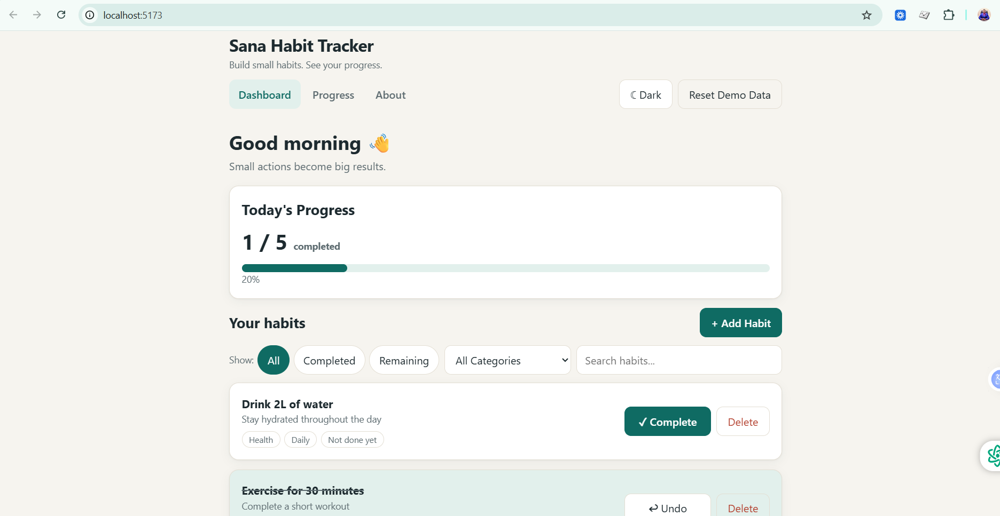

### 2. Firebase Project


### 3. Firebase Web App

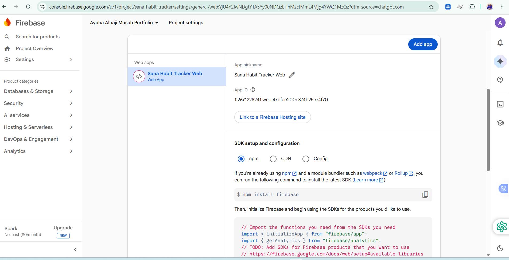

### 4. GA4 Data Stream

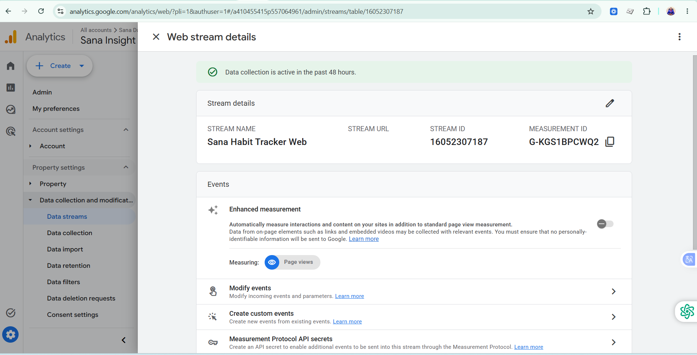

### 5. Firebase Analytics Implementation

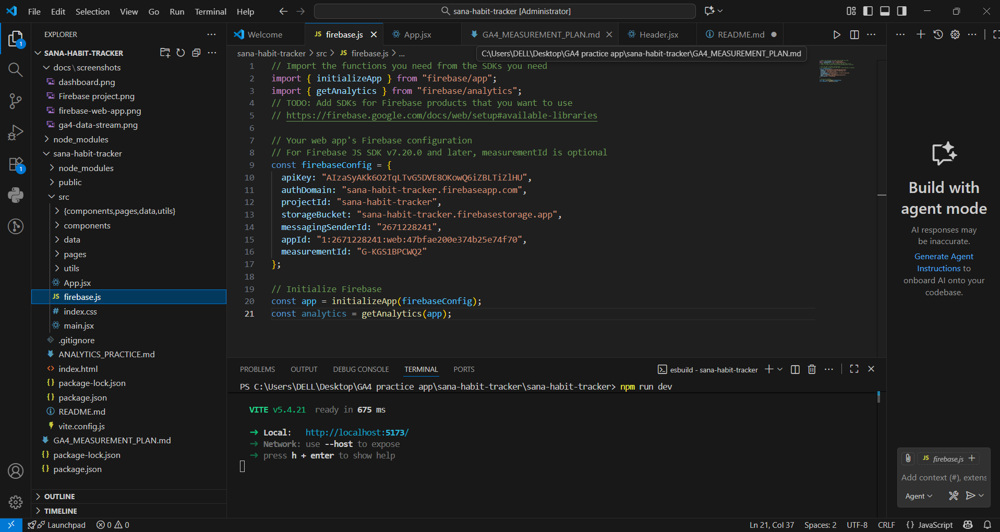

### 6. Firebase Analytics Event Firing

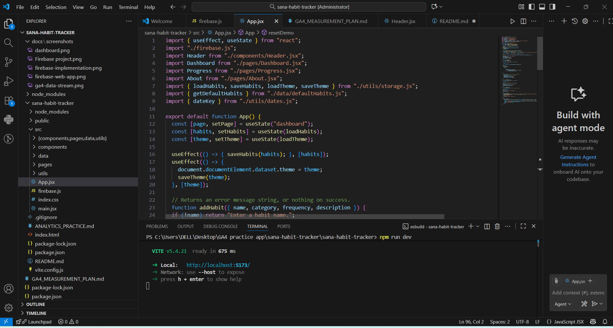

### 7. GA4 DebugView

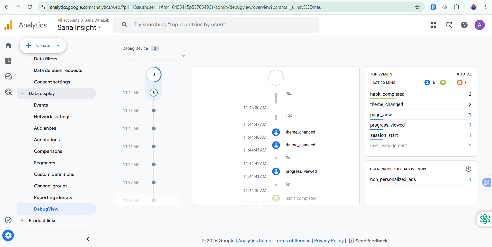

### 8. `habit_completed` Event Details

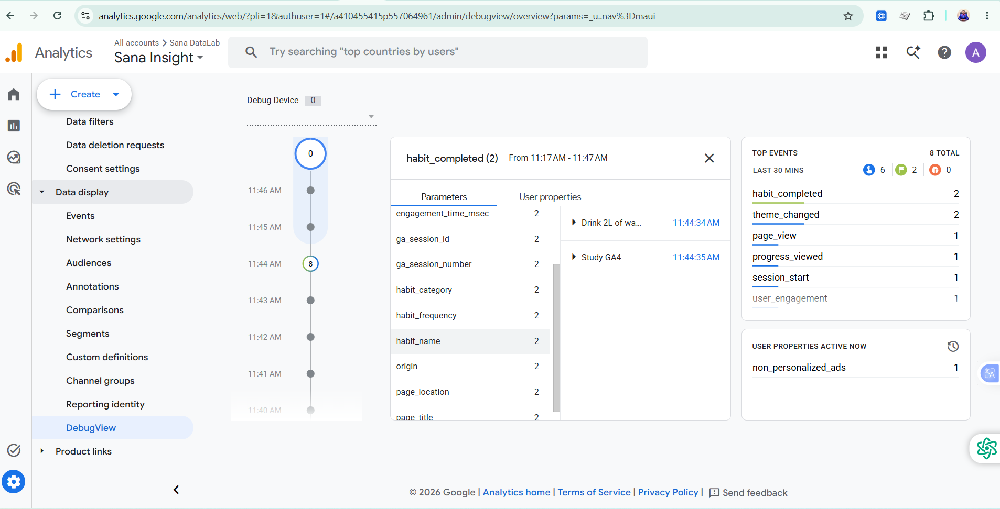

### 9. GA4 Custom Dimensions

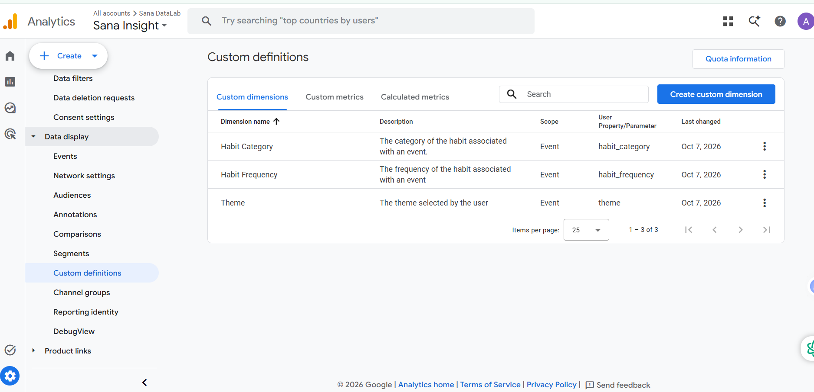

### 10. GA4 Events Report

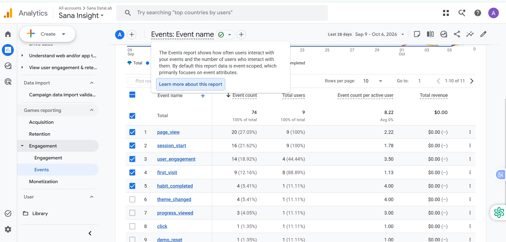

### 11. Habit Category Analysis

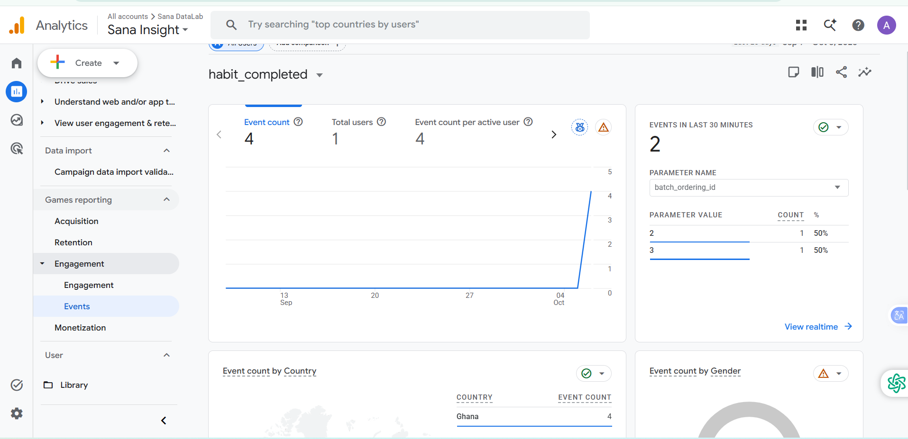

### 12. GA4 Exploration

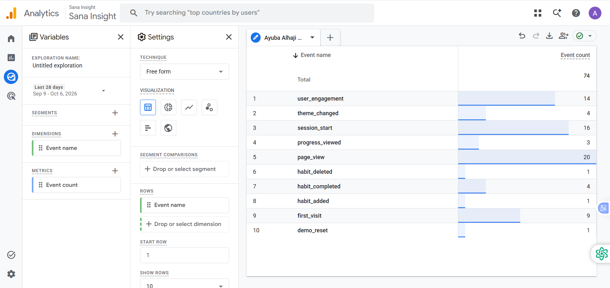

### 13. GA4 Key Event Configuration

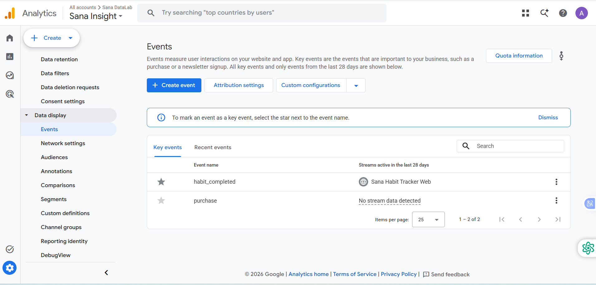


# Measurement Documentation

The detailed measurement strategy is documented separately in:

```text
GA4_MEASUREMENT_PLAN.md
```

That document contains the project's:

* Event taxonomy
* Technical implementation
* Analytics questions
* Data-quality considerations
* Analytics architecture

The README provides the portfolio-level narrative, while the measurement plan provides the detailed implementation documentation.

---

# Project Status

**Application:** Complete
**Firebase Integration:** Complete
**GA4 Integration:** Complete
**Custom Events:** Implemented
**Custom Dimensions:** Implemented
**DebugView Validation:** Complete
**Key Event:** `habit_completed` configured
**Initial GA4 Reporting:** Complete
**Data Quality Investigation:** Identified
**Analytics Exploration:** Next stage
**Portfolio Case Study:** In progress

---

# Next Steps

The next stage of the project is to build a GA4 Exploration that analyzes:

**Habit Completion → Habit Category → Habit Frequency**

The resulting analysis will be used to demonstrate how raw event data can be transformed into product insights and recommendations.

---

## Author

**Ayuba Alhaji Musah**

Land Economist / Property professional, transitioned into Data Analytics and Data Science, with an interest in using data, technology and analytics to solve real-world problems.

**Focus Areas:** Data Analytics · Product Analytics · Business Intelligence · Data Science and ML · Real Estate Analytics · GA4

---

## License

This project is intended primarily as a learning, demonstration and portfolio project.
